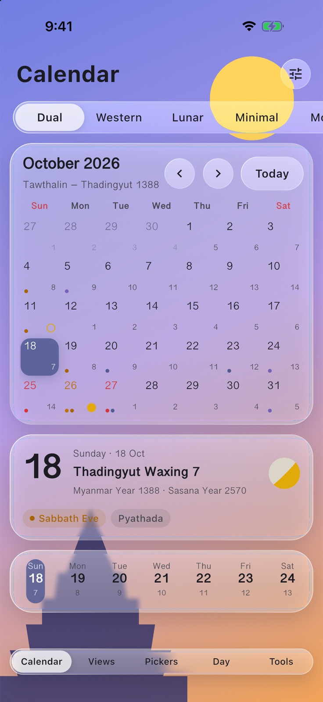
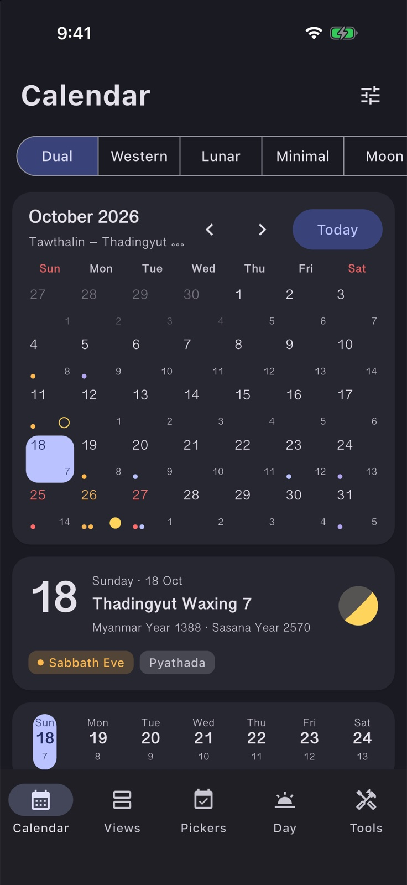
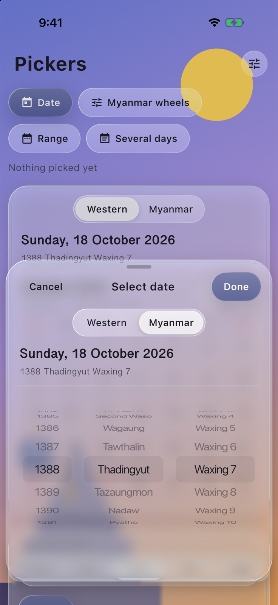
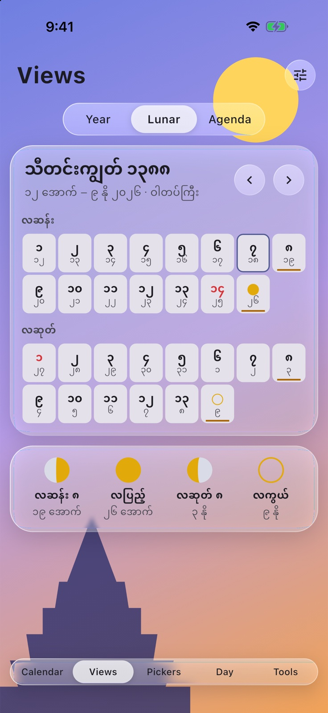
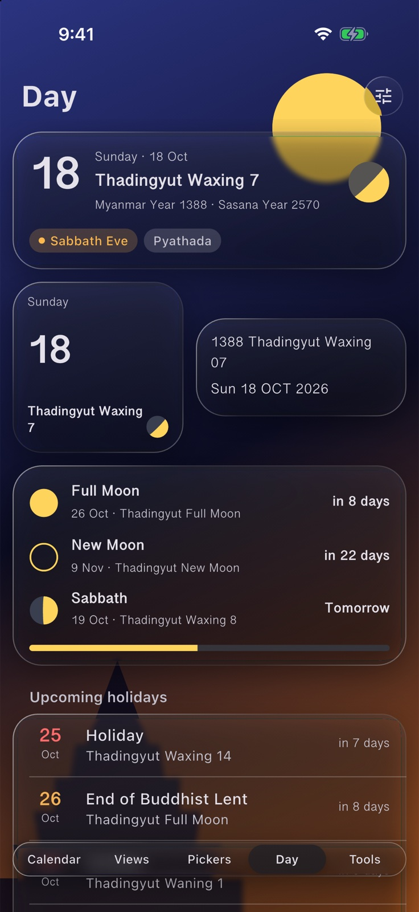
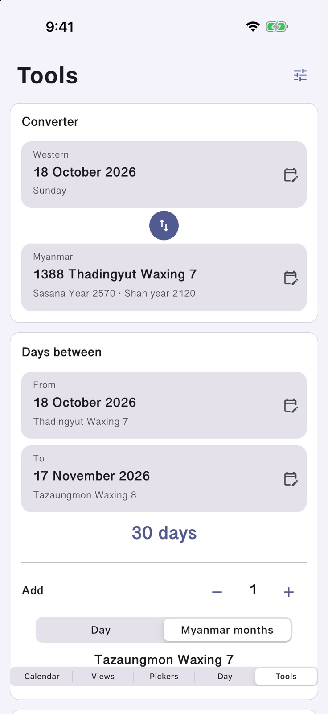
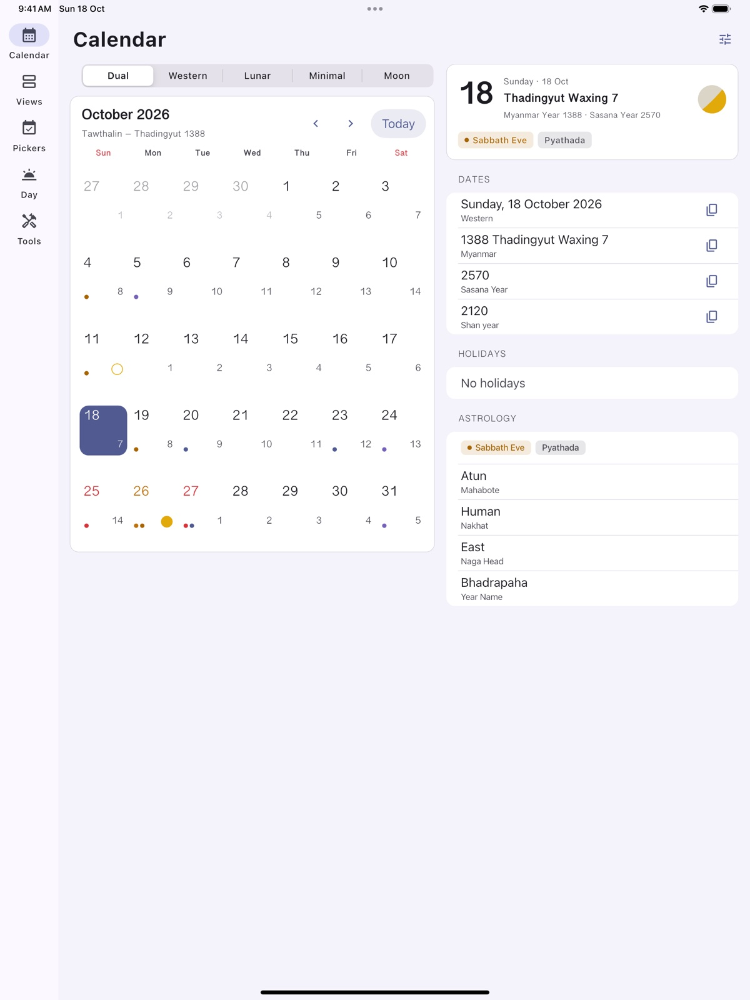

# flutter_mmcalendar

Myanmar calendar widgets for Flutter, built on
[`myanmar_calendar_dart`](https://pub.dev/packages/myanmar_calendar_dart).
Every widget renders as **Material 3**, **Cupertino** or **Liquid Glass**
from one scope and one theme. Each widget shows both calendars, plus what the
core computes for the day: holidays by type, Sabbath, moon phases,
astrology, the Shan and Sasana years and the chronicles.

[](https://github.com/mixin27/flutter-mmcalendar/actions/workflows/flutter.yaml)
[](https://pub.dev/packages/flutter_mmcalendar)
[](https://opensource.org/licenses/MIT)

| Liquid Glass | Material 3, dark | Myanmar wheels | Lunar month, in Myanmar |
| --- | --- | --- | --- |
|  |  |  |  |

| Day, dark glass | Tools, Cupertino |
| --- | --- |
|  |  |



## Installation

```yaml
dependencies:
  flutter_mmcalendar: ^4.0.0
```

This package re-exports `myanmar_calendar_dart`, so one import gives you
both the widgets and the calendar API. It needs Flutter 3.41 or later.

## Quick start

Put a `MyanmarCalendarScope` near the top of the app. Every calendar widget
below it shares its client (configuration, custom holidays and the day
cache), language, style and theme.

```dart
import 'package:flutter/material.dart';
import 'package:flutter_mmcalendar/flutter_mmcalendar.dart';

void main() {
  // Optional: load the glass shader before the first frame.
  MmGlass.precache();
  runApp(
    MyanmarCalendarScope(
      language: Language.myanmar, // leave out to follow the app's locale
      style: MmVisualStyle.automatic, // or material, cupertino, glass
      child: MaterialApp(
        theme: ThemeData(colorSchemeSeed: Colors.indigo),
        home: const HomePage(),
      ),
    ),
  );
}

class HomePage extends StatefulWidget {
  const HomePage({super.key});

  @override
  State<HomePage> createState() => _HomePageState();
}

class _HomePageState extends State<HomePage> {
  final controller = MyanmarCalendarController(
    selection: SingleSelection(DateTime.now()),
  );

  @override
  void dispose() {
    controller.dispose();
    super.dispose();
  }

  @override
  Widget build(BuildContext context) {
    return Scaffold(
      body: ListView(
        padding: const EdgeInsets.all(12),
        children: [
          MyanmarMonthCalendar(
            controller: controller,
            onDayTapped: (day) => debugPrint(day.myanmar.toString()),
          ),
          const SizedBox(height: 12),
          ListenableBuilder(
            listenable: controller,
            builder: (context, _) => MyanmarTodayCard(
              date: controller.selection.days.firstOrNull,
            ),
          ),
        ],
      ),
    );
  }
}
```

## Styles

`MmVisualStyle.automatic` picks:

- Cupertino on iOS and macOS;
- Glass on iOS and macOS 26 and later;
- Material everywhere else.

Set `style` on the scope to choose one for the whole app, or pass `style:` to
a single widget.

| Style | What it looks like |
| --- | --- |
| `material` | Tonal surfaces from the app's `ColorScheme`, Material buttons, segmented buttons and dialogs. |
| `cupertino` | Grouped lists, hairline edges, `CupertinoButton`, sliding segmented controls and sheets with a grabber. |
| `glass` | Translucent panels that bend what is behind them at the rim, capsule controls and floating sheets. |

Glass is drawn in Flutter, with no platform views or native code:

- **On Impeller:** `MmGlass` runs the backdrop through a refraction shader
  bundled with the package.
- **On Skia, on web, and while a route is animating:** it falls back to a
  blur with a tint and a bright edge.
- **With high contrast turned on:** it draws an opaque surface instead.

Glass needs something behind it to bend: a photo, a gradient, or content
scrolling underneath.

## Theme

Colours come from `MmCalendarThemeData`, a `ThemeExtension`. Without one,
widgets build it from the app's `ColorScheme`, so light and dark mode follow
the app. Holiday, Sabbath and moon colours are fixed per brightness so they
mean the same thing in every app.

```dart
ThemeData(
  colorSchemeSeed: Colors.teal,
  extensions: [
    MmCalendarThemeData.fromSeed(Colors.teal).copyWith(cellRadius: 8),
  ],
)
```

The theme also sets the Myanmar font fallback (Noto Sans Myanmar, Myanmar
Sangam MN, Padauk) and the taller line height Myanmar script needs.

## Widgets

### Calendars

| Widget | What it shows |
| --- | --- |
| `MyanmarMonthCalendar` | A month that pages by swiping. The header shows the Western month and the Myanmar months it spans, and there are five cell styles (`dual`, `westernFirst`, `lunarFirst`, `minimal`, `moon`). Holidays are coloured by type, and Sabbath, events and full and new moons are marked. It supports single, range and multi selection, and arrow keys, Page Up/Down and Home/End. |
| `MyanmarWeekStrip` | One week in a row, paging by swiping. |
| `MyanmarMiniMonth` | A compact month for sidebars and the year view. |
| `MyanmarYearCalendar` | Twelve mini months with holidays and full moons. |
| `MyanmarLunarMonthCalendar` | A Myanmar month laid out as it is counted: waxing 1–15, then waning, with First and Second Waso in watat years. |
| `MyanmarAgenda` / `MyanmarAgendaSliver` | The days that have holidays, anniversaries, Sabbath, moon days or your events, with a pinned header per month. |

```dart
MyanmarMonthCalendar(
  controller: MyanmarCalendarController(selection: RangeSelection()),
  cellStyle: MyanmarDayCellStyle.lunarFirst,
  firstDayOfWeek: DateTime.monday,
  eventLoader: (day) => events[day] ?? const [],
  onSelectionChanged: (selection) { /* ... */ },
  dayBuilder: (context, day, cell) => cell, // wrap or replace a cell
)
```

### Pickers

```dart
final CompleteDate? day = await showMyanmarDatePicker(
  context: context,
  initialDate: DateTime.now(),
  inputMode: MyanmarPickerInput.wheels, // or calendar
);

final MyanmarDateRange? range = await showMyanmarDateRangePicker(
  context: context,
);

final List<CompleteDate>? days = await showMyanmarMultiDatePicker(
  context: context,
);
```

Material shows a dialog; Cupertino and Glass show a sheet with Cancel and
Done. Each picker has a Western / Myanmar switch and a month-year grid
behind the calendar title.

| Widget | What it shows |
| --- | --- |
| `MyanmarDatePicker` | The picker's content, for use inline. |
| `MyanmarDateWheelPicker` | Year, month and fortnight-day wheels that only offer days that exist. |
| `MyanmarMonthYearPicker` | A month grid for jumping to a month. |
| `MyanmarDateFormField` | A `FormField<CompleteDate>` with validation. |

### Day information

| Widget | What it shows |
| --- | --- |
| `MyanmarDateText` | A date formatted with the core's patterns. `.today()` turns over at midnight. |
| `MyanmarTodayCard` | The day at a glance. `.compact` is a home-screen-sized square. |
| `MyanmarDayDetails` | Dates, moon, holidays and astrology in sections, each date with a copy button. |
| `HolidayBadge`, `HolidayList.upcoming` | Holidays coloured by type, and a countdown to the next ones. |
| `AstroBadges`, `AstrologyCard`, `NagahleCompass` | Sabbath, Yatyaza, Pyathada, mahabote, nakhat, the year name and the dragon's direction. |
| `MoonGlyph`, `MoonPhaseStrip`, `NextMoonCountdown` | A drawn moon for any day, a month's quarter days, and days until the next full moon, new moon and Sabbath. |

### Tools

| Widget | What it does |
| --- | --- |
| `MyanmarDateConverter` | Converts between Western and Myanmar dates, with a swap button. |
| `DateDifferenceCard` | The days between two dates, and a date plus days or Myanmar months. |
| `AIPromptAction` | Builds horoscope, fortune or divination prompts and hands them to your callback; it never copies or sends anything itself. |
| `ChronicleCard` | The eras running on a date and the dated records near it. |

### Building blocks

`MmSurface`, `MmGlass`, `MmButton`, `MmIconButton`, `MmChip`,
`MmSegmented`, `MmListGroup`/`MmListRow`, `showMmSheet` and
`showMmPopover` follow the same style. Use them so the rest of your screen
matches the calendar.

## Languages

English and Myanmar are complete. Shan, Mon, Karen and Zawgyi have the
core's date names. A few widget labels (tooltips such as "Next month",
"Today") fall back to English in those languages until you add
translations:

```dart
TranslationService.addTranslation('Next month', Language.shan, '...');
```

Digits follow the language, and screen readers hear each day in the
calendar's language. Astrology descriptions are English in
`myanmar_calendar_dart` 3.0.

## Example

The [example](example) is a gallery of every widget. Its settings sheet
switches style, theme, language, platform, week start and colour. Phones
get a bottom bar, and wider windows get a rail, a sidebar and an inspector.

```bash
cd example
flutter run
```

## Migrating from 3.x

4.0 replaces every widget. Wrap your app in a `MyanmarCalendarScope`, then
switch each 3.x widget to its 4.0 replacement:

| 3.x | 4.0 |
| --- | --- |
| `MyanmarCalendarWidget` | `MyanmarMonthCalendar` with a `MyanmarCalendarController` |
| `CalendarSelectionMode.single/range/multi` | `SingleSelection`, `RangeSelection`, `MultiSelection` on the controller |
| `onDateSelected`, `onRangeSelected`, `onMultiSelected` | `onDayTapped` (a `CompleteDate`) and `onSelectionChanged` |
| `cellBuilder` | `dayBuilder(context, MyanmarDayData day, Widget cell)` |
| `MyanmarCalendarTheme`, `theme:` on each widget | `MmCalendarThemeData` in `ThemeData.extensions` or on the scope |
| `language:` / `config:` on each widget | `MyanmarCalendarScope(language:, config:)` |
| `MyanmarDatePickerWidget` | `MyanmarDatePicker` |
| `showMyanmarDatePicker(...)` (returned `CompleteDate`) | `showMyanmarDatePicker(...)` (new parameters, still `CompleteDate`) |
| `showMyanmarDatePickerFullscreen` | `showMyanmarDatePicker` (a sheet in Cupertino and Glass) |
| `MyanmarDatePickerFormField`, `MyanmarDateField` | `MyanmarDateFormField` (`FormField<CompleteDate>`) |
| `MyanmarCalendarToolbar` | `MyanmarCalendarHeader` |
| `MyanmarDateSummaryCard` | `MyanmarTodayCard` |
| `HoroscopeWidget` | `AstrologyCard` and `AIPromptAction` |
| `MoonPhaseView`, `DailyMoonPhaseWidget`, `MoonPhasePainter` | `MoonGlyph`, `MoonPainter` |
| `PackageConstants`, performance and accessibility helpers | Removed; widgets handle semantics and caching themselves |
| `DateConverter`, `MyanmarCalendarService` (re-exported from `src/`) | `MyanmarCalendarClient` |

The core library moved to 3.x as well; see its
[changelog](https://pub.dev/packages/myanmar_calendar_dart/changelog). In
short:

- `MyanmarCalendar.generateAIPrompt` is now `AIPromptService.generatePrompt`.
- `getCacheStatistics()` is typed.
- `parseMyanmar` throws `DateParseException`.
- Holidays follow the reference calendar.

## Changelog

See [CHANGELOG.md](CHANGELOG.md).

## License

MIT; see [LICENSE](LICENSE).
